# Direção visual do portal (R0 do redesenho)

**Estado:** R0, a escolher pelo responsável (2026-11-13). Duas direções, a mesma estrutura de tela e o mesmo protótipo (`frontend/prototypes/r0/`). A direção muda só pelos tokens (`?direcao=a|b`, `?tema=claro|escuro`). Os problemas que elas resolvem estão em `AUDITORIA_UX.md`.

**Para quem é:**
- técnicos N1 e N2, o dia inteiro, no computador e às vezes no celular;
- gestão e Liderança acompanhando a operação ao vivo, inclusive numa tela fixa.

Um portal operacional precisa de três coisas que o visual de hoje não entrega:
- ler um número ou uma situação de relance;
- achar a ação certa sem procurar;
- cansar pouco depois de oito horas.

**O que vale para as duas direções** (a estrutura do protótipo):
- **Interface quase toda neutra.** A cor fica para a situação das pessoas (presencial, remoto, pausa, almoço, ausente), que é a informação.
- **Um título por tela,** no topo. Nada de sobretítulo, descrição de marketing ou cartão de abertura.
- **Lista densa, não grade de cartões.** Cada linha é uma pessoa; a situação tem ícone e rótulo em caixa normal; o tempo de pausa fica em fonte monoespaçada com dígitos de mesma largura, para não pular.
- **Números de verdade no topo,** com a composição (barra de partes com legenda e número) no lugar de oito cartões iguais.
- **Uma ação principal cheia por vista.** O resto é botão secundário ou texto.
- **Movimento discreto:**
  - só cor de fundo e de borda em 120 ms;
  - o botão desce 1 px ao ser pressionado;
  - nada sobe, brilha, desfoca ou entra rolando;
  - sob `prefers-reduced-motion`, nada se move.
- **CSP do portal** (`style-src 'self'`): nenhum atributo `style`, nenhum recurso externo, fontes auto-hospedadas com `font-display: swap` (registro em `frontend/prototypes/r0/fontes/README.md`).

---

## 1. As duas direções lado a lado

Capturas do protótipo em `capturas/depois/`: as 3 telas nas duas direções e nos dois temas, em 1280 e 390 px, mais a pausa em andamento e o painel de edição aberto. A comparação abaixo usa o tema padrão de cada direção. As capturas "antes" das mesmas telas estão na seção 6.

| | A · Mesa clara (recomendada) | B · Sala de controle |
|---|---|---|
| Pausas | 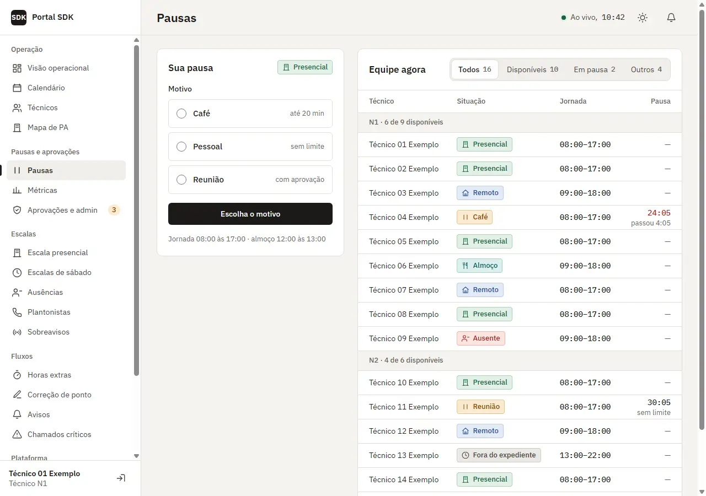 | 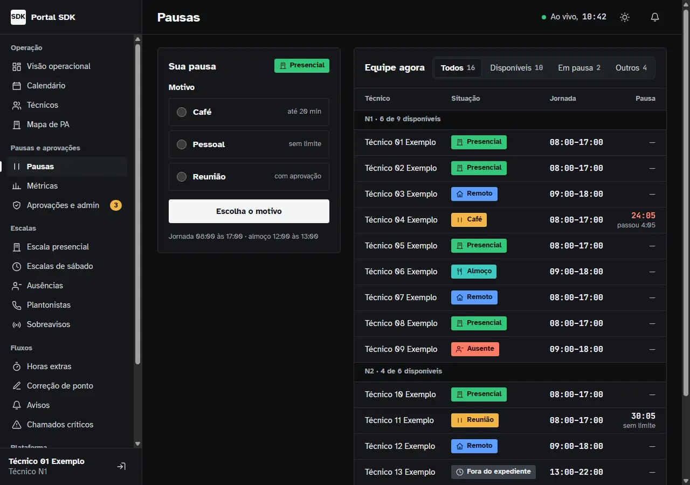 |
| Visão operacional | 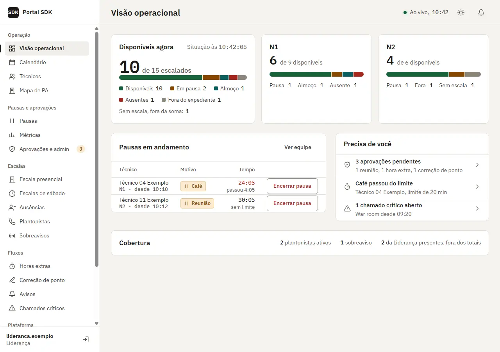 | 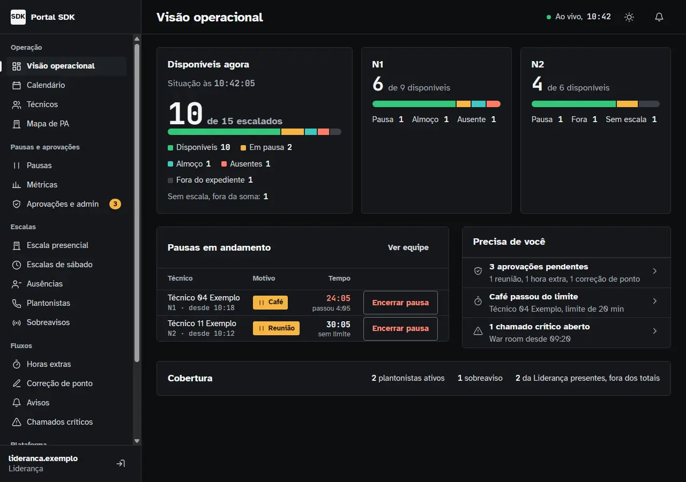 |
| Funcionários | 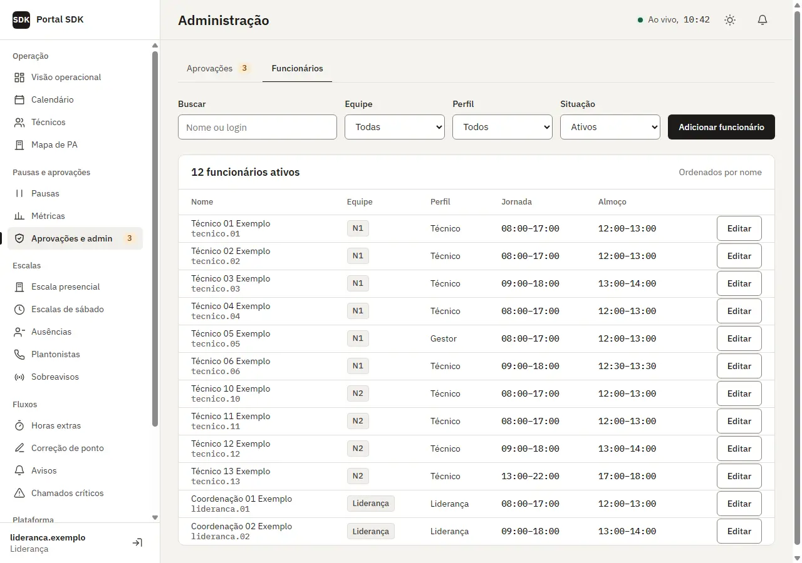 | 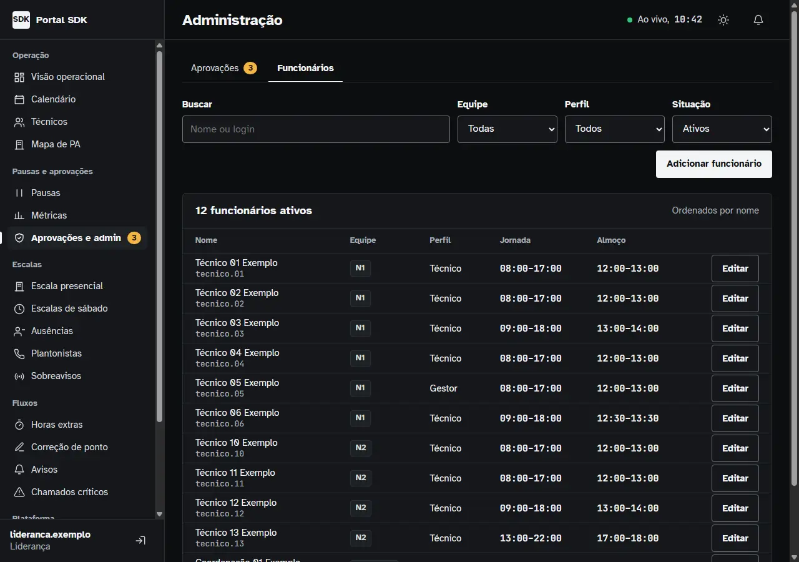 |
| Pausa em andamento, 390 | 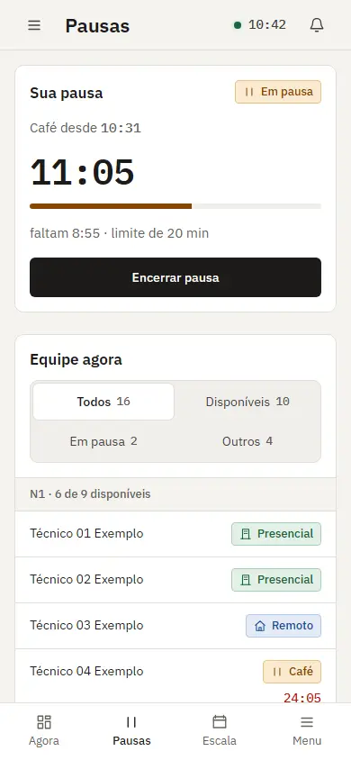 | 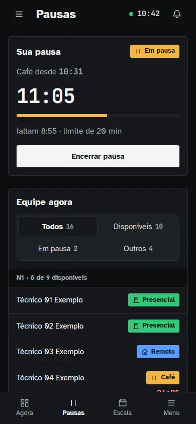 |
| Tema alternativo | 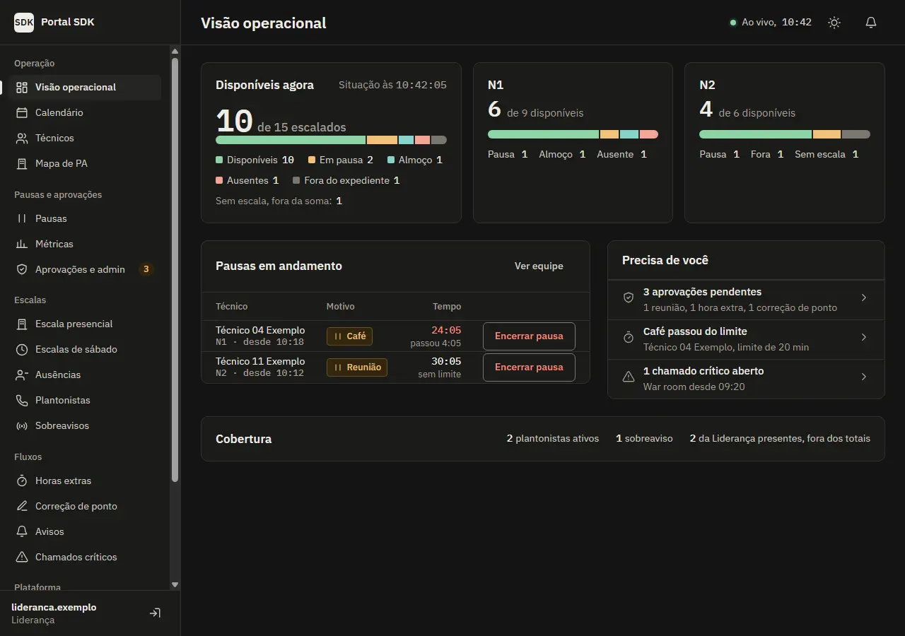 | 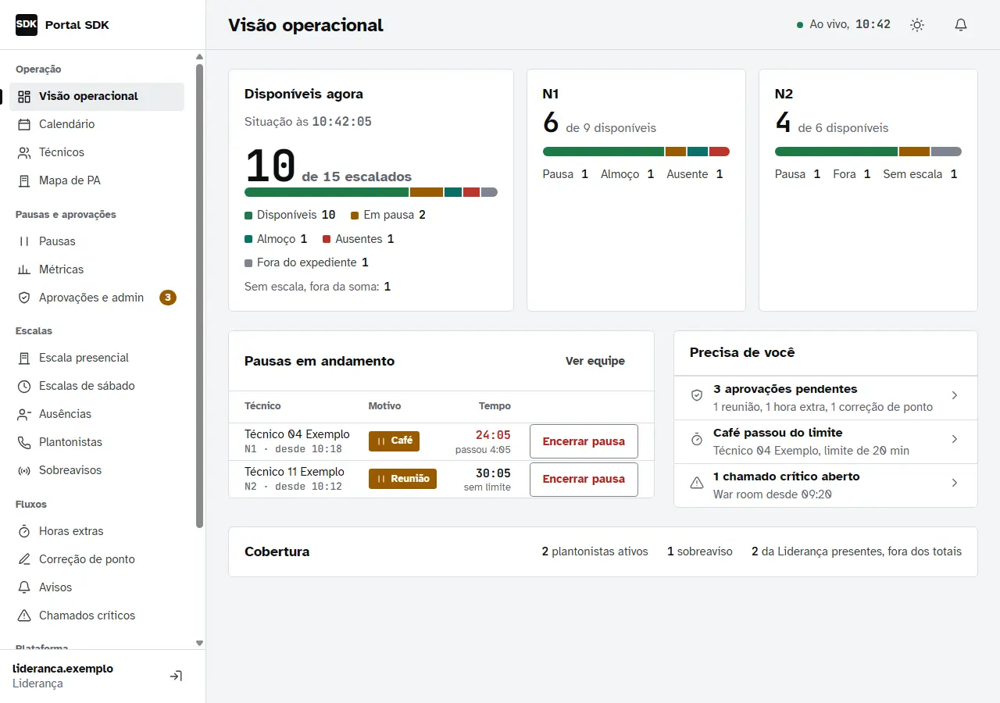 |

---

## 2. Direção A · Mesa clara

**A ideia:** uma mesa de trabalho bem arrumada. Papel quente, tinta quase preta, cor só onde há uma situação. Lembra um bom sistema de gestão ou um documento técnico bem diagramado, não um painel de ficção científica. É a mais distante do visual de hoje e do "dashboard escuro com ciano" que denuncia a origem.

| Item | Proposta |
|---|---|
| Tipografia | **IBM Plex Sans** 400, 500 e 600 no texto; **IBM Plex Mono** 500 e 600 nos números, horários e logins (OFL 1.1). Plex foi desenhada para interface técnica, tem acentos bem resolvidos e números legíveis. Não é a Inter que todo painel gerado usa |
| Escala | base 15 px; tabela 14 px; rótulo 13 px (o menor tamanho); título da tela 22 px/600; título de bloco 17 px/600; número 32 px; número de destaque 44 px. Rótulo sempre em caixa normal, sem espaçamento extra |
| Espaçamento | múltiplos de 4: 8, 12, 16, 20, 24, 28, 40. Bloco com 20 px de margem interna; 24 px entre blocos; 16 px no celular |
| Densidade | linha de tabela com 44 px; controle com 40 px no computador e 44 px no celular |
| Raio | 6 px nos controles, 10 px nos blocos, 4 px nas etiquetas de situação |
| Sombra | nenhuma, só no painel lateral sobreposto (uma) |
| Bordas | linha de 1 px em `--line`; borda de campo em `--line-strong` com 3:1 ou mais |
| Situação | tinta escura sobre tom claro da mesma cor, com borda; ícone e rótulo sempre |
| Movimento | cor em 120 ms; pressão de 1 px; nada mais |

**Tokens, tema claro (padrão):**

| Token | Cor | Uso |
|---|---|---|
| `--bg` | `#F4F3EF` | fundo |
| `--surface` | `#FFFFFF` | bloco |
| `--surface-2` | `#F0EEE9` | hover, faixa de grupo |
| `--line` | `#E1DED6` | linha |
| `--line-strong` | `#8A8478` | borda de campo |
| `--ink` | `#1C1B19` | texto |
| `--ink-2` | `#45423C` | texto secundário |
| `--muted` | `#67635B` | rótulo, horário |
| `--focus` | `#2F56D6` | anel de foco |
| `--action-bg` / `--action-ink` | `#1C1B19` / `#FFFFFF` | botão principal |
| `--danger` | `#B42318` | erro, pausa estourada |

**Tokens, tema escuro:**

| Token | Cor | Uso |
|---|---|---|
| `--bg` | `#141413` | fundo |
| `--surface` | `#1B1B19` | bloco |
| `--surface-2` | `#252522` | hover, faixa de grupo |
| `--line` | `#33322E` | linha |
| `--line-strong` | `#7A766D` | borda de campo |
| `--ink` | `#EEECE6` | texto |
| `--ink-2` | `#CFCBC2` | texto secundário |
| `--muted` | `#A29E95` | rótulo, horário |
| `--focus` | `#8EA8FF` | anel de foco |
| `--action-bg` / `--action-ink` | `#EEECE6` / `#141413` | botão principal |
| `--danger` | `#FF8A7A` | erro, pausa estourada |

O escuro é grafite quente, não ardósia azulada.

**Situações (texto sobre fundo; claro → escuro):**

| Situação | Tema claro | Tema escuro |
|---|---|---|
| Presencial / Disponível | `#17633A` sobre `#E2F0E6` | `#8FD4A5` sobre `#1B2E22` |
| Remoto | `#1F4E96` sobre `#E3EBF7` | `#9DBBEF` sobre `#1B2536` |
| Em pausa | `#864700` sobre `#FBEBD0` | `#F2C27A` sobre `#33270F` |
| Almoço | `#0B5E5E` sobre `#DDF0EE` | `#86D3CB` sobre `#142D2B` |
| Ausente | `#A3261B` sobre `#FBE5E1` | `#F4A497` sobre `#3A1E1A` |
| Fora do expediente | `#45423C` sobre `#E9E7E2` | `#CFCBC2` sobre `#2A2A27` |
| Sem escala | contorno tracejado `#8A8478`, sem fundo | contorno tracejado `#7A766D`, sem fundo |

**Por que serve a um portal operacional:**
- **O fundo claro e quente cansa menos** num escritório iluminado, durante 8 horas. Fica bom impresso e no projetor.
- **A situação salta da tela** porque é a única cor.
- **O tema escuro existe:** turno da noite, quem prefere e tela fixa (seção 4).

---

## 3. Direção B · Sala de controle

**A ideia:** uma sala de controle de verdade. Grafite neutro, situação em blocos cheios de cor que se leem a 3 metros, fonte desenhada para legibilidade. Escura por padrão.

| Item | Proposta |
|---|---|
| Tipografia | **Atkinson Hyperlegible** 400 e 700 no texto (feita para baixa visão: letras ambíguas desenhadas para não se confundir, e o zero cortado); **JetBrains Mono** 500 e 700 nos números (OFL 1.1) |
| Escala | base 16 px; tabela 15 px; rótulo 13 px; título da tela 24 px; número 36 px; número de destaque 56 px |
| Espaçamento | o mesmo da A, com linha de tabela de 48 px e controle de 44 px |
| Raio | 4 px nos controles e 6 px nos blocos: mais seco |
| Sombra | nenhuma, só no painel lateral |
| Situação | bloco cheio da cor, com texto escuro (escuro) ou branco (claro); ícone e rótulo sempre |
| Movimento | o mesmo da A |

**Tokens, tema escuro (padrão):**

| Token | Cor |
|---|---|
| `--bg` | `#0D0E10` |
| `--surface` | `#15171A` |
| `--surface-2` | `#1E2125` |
| `--line` | `#2B2F35` |
| `--line-strong` | `#6E757F` |
| `--ink` | `#F3F4F6` |
| `--ink-2` | `#D3D7DD` |
| `--muted` | `#A4ABB5` |
| `--focus` | `#7CC4FF` |
| `--action-bg` / `--action-ink` | `#F3F4F6` / `#0D0E10` |

**Situações, tema escuro (fundo do bloco):**

| Situação | Fundo |
|---|---|
| Presencial | `#34C77B` |
| Remoto | `#5B9DFF` |
| Em pausa | `#F5B544` |
| Almoço | `#3CC9C0` |
| Ausente | `#FF7A66` |
| Fora do expediente | `#3A3F46` |

**Tokens, tema claro:**
- base: `--bg #F3F4F5`, `--surface #FFFFFF`, `--ink #0D0E10`, `--muted #5F6670`, `--line-strong #7D848E`, `--focus #1F5FD1`;
- situações: blocos `#1D7A47`, `#2A5FBF`, `#9A5B00`, `#0B6F69`, `#B8342A` e `#5F6670`, com texto branco.

**Por que serve:** a melhor leitura à distância e em tela fixa; os blocos cheios mostram a composição da equipe de longe.

**Por que não é a recomendada:**
- **O escuro como padrão** num escritório iluminado cansa mais em texto corrido (formulários, Escala, Chamados críticos).
- **Os blocos cheios** pesam numa lista de 16 pessoas o dia inteiro.
- **É a mais próxima do visual de hoje,** e o objetivo é sair dele. O ganho principal dela, a leitura à distância, cabe na A como modo painel.

---

## 4. Recomendação

**Direção A, com os dois temas, e o claro como padrão:**
- **Tema claro:** padrão para todos.
- **Tema escuro:** pela preferência do sistema (`prefers-color-scheme`) ou por um botão no topo, que o legado já tinha. A escolha fica na conta do usuário, não no navegador: o `localStorage` é proibido no `src/` pelo `qa:visual`.
- **Modo painel, para a tela fixa:** só a Visão operacional, no tema escuro da A, com os números no tamanho de destaque, sem menu e sem ações. Fica para o lote da Visão operacional (R4 em `PLANO_LOTES_R.md`).

**O que custa cada opção:**

| Opção | R1 (tokens) | Testes e capturas | Risco |
|---|---|---|---|
| **Só claro** | 1 conjunto de tokens | 1 rodada de capturas por lote; o navegador roda num tema | Quem trabalha à noite e a tela fixa ficam sem tema escuro; o legado tinha alternância |
| **Só escuro** | 1 conjunto | Igual | Mantém o cansaço do escuro em texto corrido; afasta pouco do visual de hoje |
| **Os dois, claro padrão (recomendada)** | 2 conjuntos, cerca de 60 linhas a mais. O `contraste.mjs` já confere os dois | Capturas dobram; os 1029 checks do navegador rodam no padrão, e um teste de fumaça no outro tema confere que nada some (cor de texto igual à do fundo) | Baixo, se toda cor vier de token. O R1 trava cor solta no `src/` (QA novo) |

**Contraste do protótipo** (`node frontend/prototypes/r0/contraste.mjs`):
- 24 pares por tema, 0 falhas nos quatro;
- menor contraste de texto: A claro 5,16:1, A escuro 5,75:1, B escuro 6,85:1, B claro 4,99:1 (mínimo 4,5:1);
- menor contraste de borda de campo: de 3,72 a 3,86:1 (mínimo 3:1).

**Alvo de toque e rolagem lateral** (`capturar.mjs verificar`): em 390 px, 0 alvos abaixo de 40 px e 0 rolagens laterais nas 12 combinações.

---

## 5. Decisões a confirmar

| # | Decisão | Recomendação | O que muda conforme a resposta |
|---|---|---|---|
| D-R0-1 | Direção | **A · Mesa clara** | B: as mesmas telas com os tokens da B; o R1 leva Atkinson e JetBrains Mono no lugar do Plex |
| D-R0-2 | Temas | **Os dois, claro padrão**, escuro pela preferência do sistema e por um botão | Só um: R1 menor e capturas pela metade (seção 4) |
| D-R0-3 | Fontes no app | **IBM Plex Sans (400, 500, 600) e IBM Plex Mono (500)**, latino, cerca de 85 KB em woff2 | Fonte do sistema: 0 KB, mas cada estação mostra uma fonte diferente (Segoe UI, Ubuntu, Roboto) |
| D-R0-4 | Cores das situações | **Em pausa: âmbar** (sai o violeta da DV7 do F7); **Almoço: verde-azulado** (sai o amarelo forte); **Ausente: vermelho** (sai o laranja). Cada situação continua com ícone e rótulo, e nenhuma depende só da cor | Manter as cores da DV7 e do F5: o violeta fica (sinal S13 da auditoria) |
| D-R0-5 | Iniciar pausa | **Escolha visível e um botão que diz a ação** (2 ações; hoje são 3) | Um clique só: mais rápido, mas sem passo para desfazer o toque errado. Pediria um "desfazer" no servidor, e isso é regra, fora do redesenho |
| D-R0-6 | Editar funcionário | **Painel lateral**, com a lista visível atrás; "Adicionar" vira um botão que abre o mesmo painel | Manter o diálogo central de hoje |
| D-R0-7 | Atalhos no celular | **Barra fixa com 4 itens** (Agora, Pausas, Escala, Menu), alvo de 48 px | Só o menu lateral, como hoje |
| D-R0-8 | Textos explicativos (S9) | **Sair** os de apresentação (descrições de tela, sobretítulos, legendas de cartão). **Ficam** os de regra e de segurança (P9, retroativo, auditoria), sem mudar uma palavra | Manter todos |
| D-R0-9 | Capturas no git | **WebP** em `docs/design/capturas/`: 3,1 MB no R0 e por volta de 1 MB por lote depois | Fora do git, só no pacote de revisão (`_revisao_*.zip`) |

---

## 6. Antes e depois das três telas

| Tela | Antes (1280) | Depois, A claro (1280) |
|---|---|---|
| Pausas (técnico) | 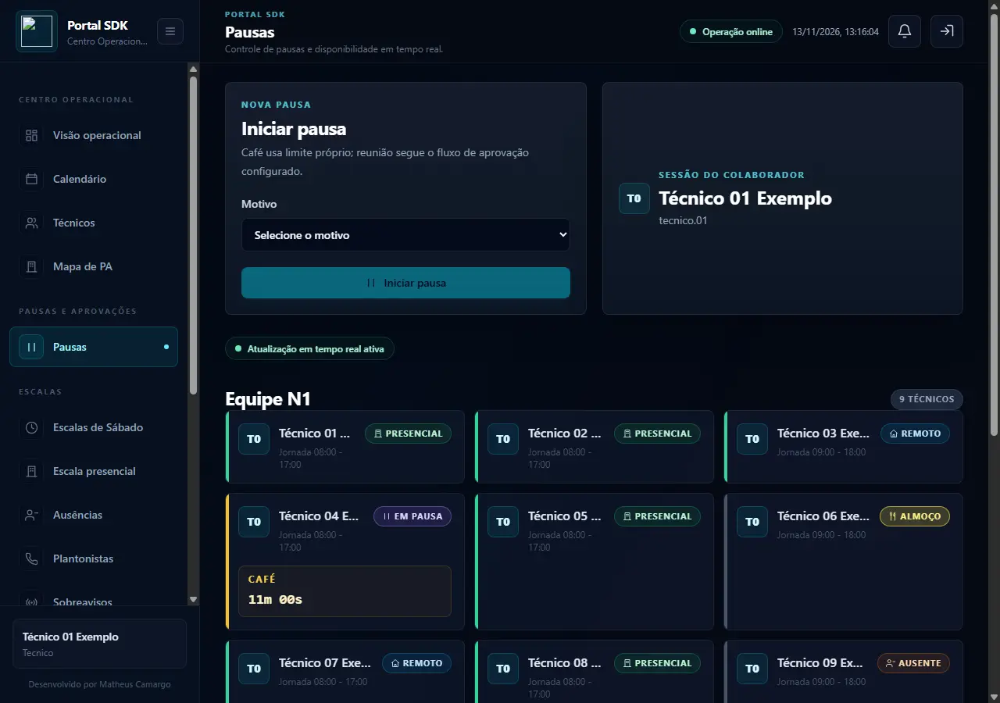 |  |
| Visão operacional (Liderança) | 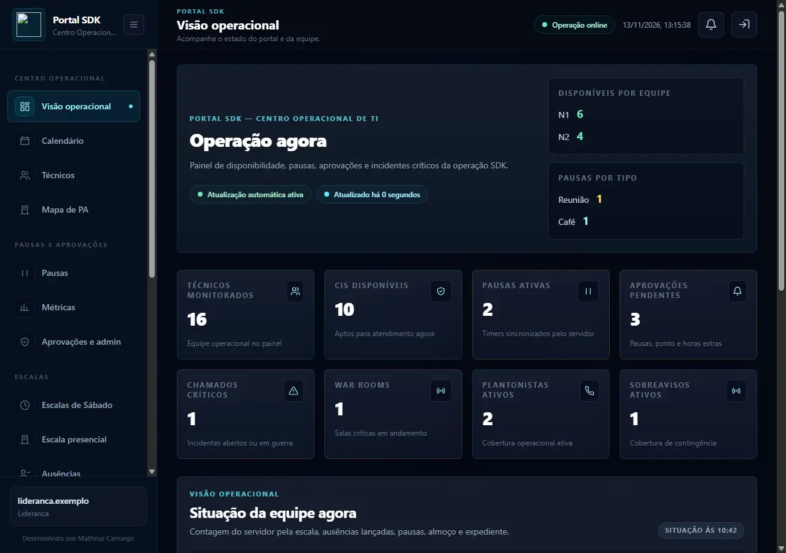 |  |
| Funcionários (Liderança) | 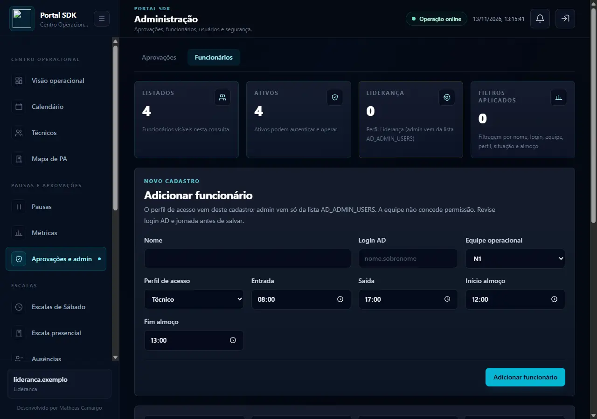 |  |

| Tela | Antes (390) | Depois, A claro (390) |
|---|---|---|
| Pausas | 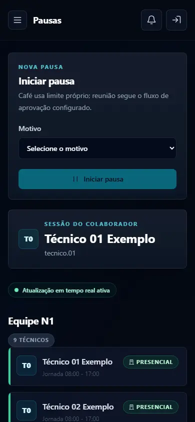 | 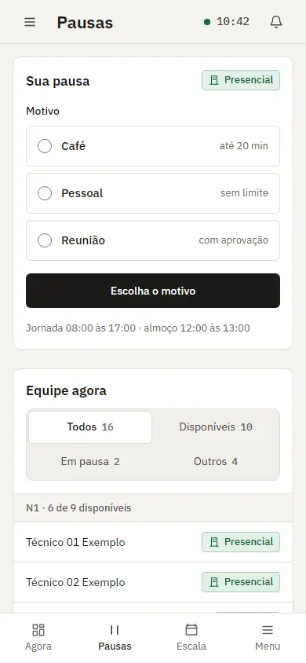 |
| Visão operacional | 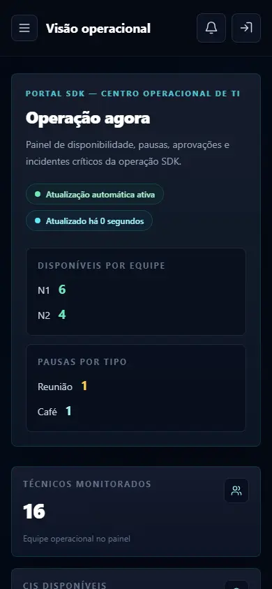 | 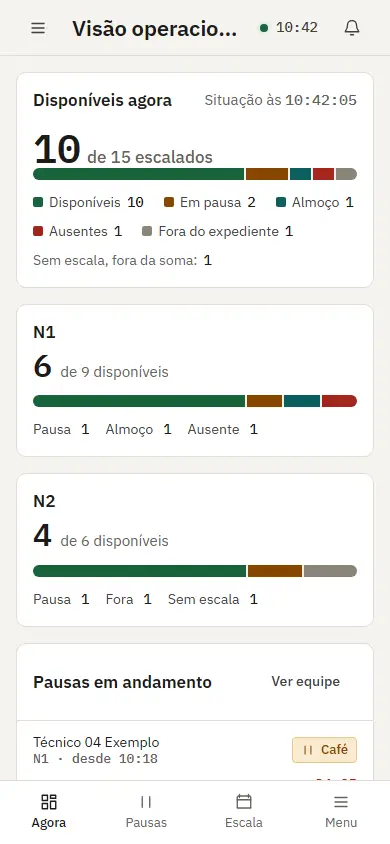 |
| Funcionários | 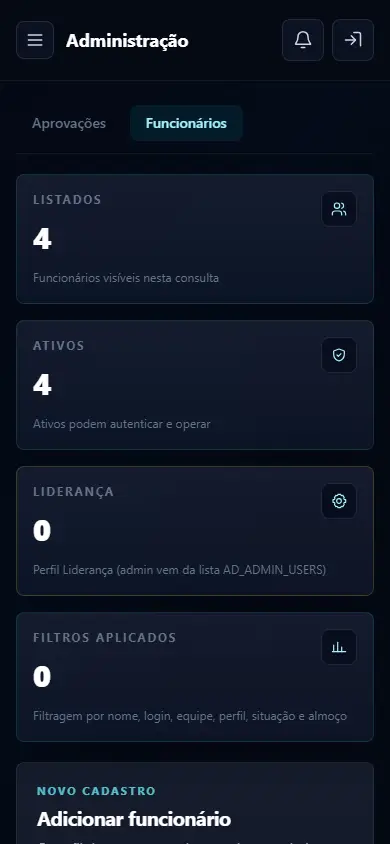 | 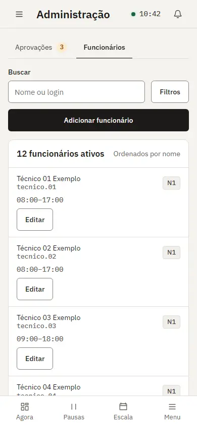 |

**Limites do protótipo:**
- só apresentação: nenhum botão grava nada;
- os números são fictícios e fixos (relógio parado em 10:42:05 nas capturas);
- o menu do celular não abre;
- os filtros de Funcionários não filtram;
- o filtro de Pausas e a escolha da pausa funcionam.
